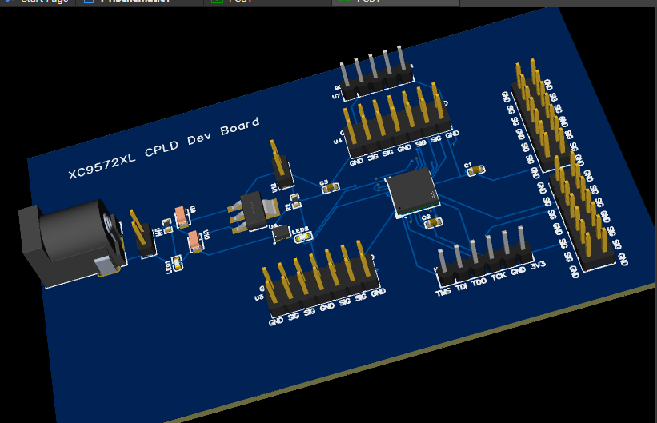
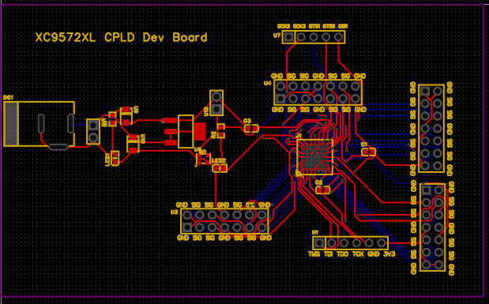
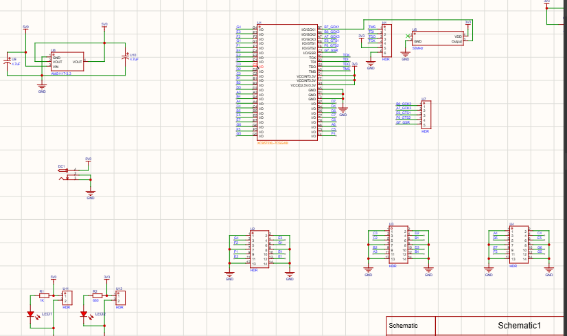

# XC9572XL CPLD Development Board

An open-source development board based on the **XC9572XL CPLD**, designed for experimenting with digital logic and programmable hardware.

## Overview

The XC9572XL CPLD Developent Board is a custom hardware project intended to make CPLD-based digital logic experiments more accessible.

## Project Images

### 3D PCB View



### PCB Layout



### Circuit Schematic



## Features

- Based on the Xilinx XC9572XL CPLD.
- Designed for digital logic experimentation.
- Manufacturing outputs provided for PCB fabrication.
- Bill of Materials (BOM) included.

## CPLD

A Complex Programmable Logic Device (CPLD) is a programmable digital logic device used to implement custom digital circuits.

It can be used to experiment with:
- Logic gates and combinational logic
- Counters and frequency dividers
  
## Repository Structure

```text
├── README.md
├── DISA_DevBoard_2026-10-24
├── DXF_DevBoard_2026-10-24
├── images
│   │   ├── pcb_3d.png
│   │   ├── pcb_layout.png
│   │   └── pcb_draw.png
├── Gerber_PCB1_2026-10-24
├── 3D_PCB
├── Bill_of_material
```

## Tools Used

- **PCB design software:** The easyeda software used to create the original design.
- **Gerber files:** Used by PCB manufacturers to fabricate the board.
- **BOM:** Used to identify and source the required components.
- **STEP model:** Used to inspect the PCB's 3D geometry.

## How to Manufacture the PCB

1. Download or clone this repository.
2. Open the original design files using the compatible CAD software.
3. Review the schematic and PCB layout.
4. Check the BOM and confirm component availability.
5. Upload the Gerber files to a PCB fabrication service.
6. Order the PCB and source the required components.
7. Assemble the board according to the schematic and component footprints.
8. Inspect the board carefully before applying power.


## How to Use the Board

Before using the board:

1. Identify the programming connector and required signals from the schematic.
2. Confirm the compatible programming hardware and software for the XC9572XL.
3. Verify the supply voltage and I/O voltage requirements.
4. Check the pin assignments before connecting external circuits.
5. Start with a simple digital logic experiment after verifying the hardware.

Add a tested programming guide and example projects when they are available.

## Current Status

- [x] PCB design files prepared
- [x] Manufacturing files exported
- [x] BOM and 3D model available
- [x] README images added
- [ ] Assembly and programming guide completed
- [ ] Physical PCB assembled and tested

